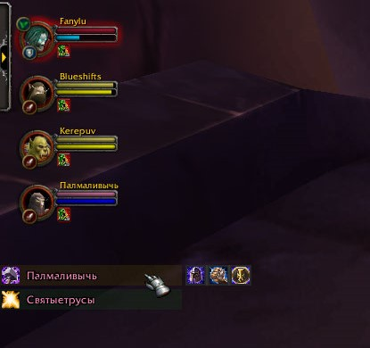

# PaladinBuffAssign

Аддон для **World of Warcraft 3.3.5a (WotLK)** — помогает распределять
благословения между паладинами в группе или рейде. Показывает полоску на
каждого паладина и позволяет назначить бафф через контекстное меню.

## Установка

1. Папку `PaladinBuffAssign` помести в `<путь к WoW>\Interface\AddOns\`
2. Перезапустить клиент (или выполнить `/reload`).

## Команды

| Команда | Действие |
|---|---|
| `/pba` | открыть / закрыть окно настроек |
| `/pba lock` | закрепить позицию |
| `/pba unlock` | разблокировать позицию (перетаскивание мышью) |
| `/pba announce` | объявить назначения в чат группы/рейда |
| `/pba reset` | сбросить настройки |
| `/pba refresh` | очистить кэш спеков и переинспектировать паладинов |
| `/pba debug` | отладочная информация |
| `/pba inspectdebug` | включить / выключить отладку инспекта |

## Возможности

- Полоска на каждого паладина в группе/рейде с цветом по специализации
  (Свет / Защита / Воздаяние).
- Горизонтальное контекстное меню для назначения баффов: Каска, Кулак,
  Мудрость, Прото.
- Определение специализации по талантам, книге заклинаний и инспекту
  (`INSPECT_TALENT_READY`).
- Назначения сохраняются между сессиями (`PaladinBuffAssignDB`).
- Оповещение о назначениях в чат группы/рейда.
